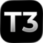

<p align="center">
  <a href="https://boltflake.github.io/t3code-nix/"></a>
  <br>
  <a href="https://boltflake.github.io/t3code-nix/"></a>
  <a href="https://boltflake.github.io/t3code-nix/"></a>
</p>

<a id="supported-systems"></a>This flake packages the [ T3 Code](https://github.com/pingdotgg/t3code) desktop app and CLI for `x86_64-linux` and `aarch64-linux`, with all ten supported agent providers plus extra agent tools. Community project, not affiliated with T3 Code or any provider vendor.


- **<ins>Always up to date</ins>.** Latest and nightly releases are detected, tested on `x86_64` and `aarch64`, and published automatically within minutes of upstream.
- **All ten agent providers:** Codex, Claude, Cursor, Grok, fx, OpenCode, Antigravity, Kiro, Muse, and pi.
- **One line to install:** `programs.t3code.enable = true;` installs the app and every provider.
- **Binary cache:** free packages on the latest channel are cached ready to download.
- **Nix in charge of updates:** built-in self-updaters are disabled; the app's update icon notifies you when `t3code-nix` has a newer T3 Code or bundled providers.

## Contents

- [Quick start](#quick-start)
- [Setup](#setup)
- [Packages](#packages)
- [The NixOS module](#the-nixos-module)
- [The Home Manager module](#the-home-manager-module)
- [Running the server](#running-the-server)
- [Binary cache](#binary-cache)
- [Unfree packages](#unfree-packages)
- [NixOS stable](#nixos-stable)
- [Troubleshooting: `t3code-nix doctor`](#troubleshooting-t3code-nix-doctor)
- [Channels, pinning and rolling back](#channels-pinning-and-rolling-back)
- [Reference and guides](#reference-and-guides)

## Quick start

Try **t3code-nix** without touching your config:

```sh
nix run github:boltflake/t3code-nix              # downloads and opens the T3 Code app, with all 10 agent providers
nix run github:boltflake/t3code-nix#t3 -- serve  # starts a T3 Code server
nix run github:boltflake/t3code-nix#codex        # runs one agent (Codex) in the terminal
```

## Setup

<details id="with-flakes" open>
<summary><b>Flake (NixOS)</b></summary>
<br>

Add `t3code-nix` and its NixOS module:

```nix
{
  inputs.t3code-nix.url = "github:boltflake/t3code-nix";
  # Don't add `inputs.t3code-nix.inputs.nixpkgs.follows`: see "Binary cache".

  outputs = { nixpkgs, t3code-nix, ... }: {
    nixosConfigurations.my-machine = nixpkgs.lib.nixosSystem {
      modules = [
        ./configuration.nix                                   # your existing system configuration
        t3code-nix.nixosModules.default
        {
          programs.t3code = {
            enable = true;

            # Optional: uncomment what you need
            # providers = [ "antigravity" "claude" "codex" ]; # install only these providers (default: all ten)
            # excludeProviders = [ "grok" ];                  # or leave some out
            # channel = "nightly";                            # T3 Code nightly (default: latest)
            # nixpkgs = "stable";                             # NixOS stable's libraries (default: unstable)
            # cli.enable = true;                              # install the `t3` CLI on PATH for terminal use and T3 Code over SSH (included automatically with `server.enable`)
            # openFirewall = true;                            # pins the desktop app to `port` (default 3773) and opens that TCP port in the firewall for Network access
            # port = 3780;                                    # desktop app port with `openFirewall` (must differ from `server.port` when running both)
            # server.enable = true;                           # keep T3 Code running in the background for your phone, laptop or browser
            # server.home = "%h/.t3-server";                  # its own T3 home, beside the desktop app's ~/.t3 (see docs/server.md)
            # server.lan = true;                              # reachable on your local network and tailnet
            # server.openFirewall = true;                     # open `server.port` (default 3773) in the firewall
                                                              # Agent Tools:
            # agentTools.agent-browser.enable = true;         # a headless browser CLI for agents (lets agents open, click and screenshot web pages)
            # agentTools.boat.enable = true;                  # boat.dev's sandbox CLI for agents
          };
        }
      ];
    };
  };
}
```

For a **headless server** (no desktop app), replace the inline module above with:

```nix
{
  programs.t3code = {
    server.enable = true;                             # keep T3 Code running in the background, with `t3` on PATH
    server.users = [ "amber" ];                       # your user name
    server.lan = true;                                # reachable on your local network and tailnet
    server.openFirewall = true;                       # open its port (3773) in the firewall

    # Optional:
    # providers = [ "antigravity" "claude" "codex" ]; # bundle only these (default: all ten)
    # agentTools.agent-browser.enable = true;
    # agentTools.boat.enable = true;
  };

  # Start the server at boot, without anyone logging in:
  users.users.amber.linger = true;
}
```

Then pair your devices with `t3 pair` (see [Running the server](#running-the-server)).

</details>

<details id="home-manager">
<summary><b>Home Manager</b> (NixOS or another Linux distro)</summary>
<br>

```nix
{
  inputs.t3code-nix.url = "github:boltflake/t3code-nix";
  # Don't add `inputs.t3code-nix.inputs.nixpkgs.follows`: see "Binary cache".

  outputs = { nixpkgs, home-manager, t3code-nix, ... }: {
    homeConfigurations.amber = home-manager.lib.homeManagerConfiguration {
      pkgs = nixpkgs.legacyPackages.x86_64-linux;
      modules = [
        ./home.nix                                            # your existing Home Manager configuration
        t3code-nix.homeModules.default
        {
          programs.t3code-nix = {
            enable = true;

            # Optional: uncomment what you need
            # providers = [ "antigravity" "claude" "codex" ]; # install only these providers (default: all ten)
            # cli.enable = true;                              # install the `t3` CLI on PATH for terminal use and T3 Code over SSH (included automatically with `server.enable`)
            # server.enable = true;                           # keep T3 Code running in the background, as your systemd user service
            # server.home = "%h/.t3-server";                  # its own T3 home, beside the app's ~/.t3
          };
        }
      ];
    };
  };
}
```

With Home Manager as a NixOS module, import `t3code-nix.homeModules.default` in `home-manager.users.<name>.imports` (or `home-manager.sharedModules`). `nix flake init -t github:boltflake/t3code-nix#home-manager` creates a standalone template. See [The Home Manager module](#the-home-manager-module) for GPU drivers, binary cache, and other Linux distros.

</details>

<details id="not-a-flake-yet">
<summary><b>If your system isn't a flake yet</b></summary>
<br>

1. Enable flakes in `configuration.nix`:

   ```nix
   nix.settings.experimental-features = [ "nix-command" "flakes" ];
   ```

2. Rebuild, then generate `/etc/nixos/flake.nix` with `t3code-nix#init`:

   ```sh
   sudo nixos-rebuild switch
   sudo nix run github:boltflake/t3code-nix#init
   sudo nixos-rebuild switch
   ```

   `init` follows your current NixOS channel, never overwrites an existing `flake.nix`, and prints any `git add` or rebuild command to run before switching (supports `--dry-run` and `--help`). Or use `nix flake init -t github:boltflake/t3code-nix` to start from the template manually.

</details>

<details id="without-flakes">
<summary><b>Without flakes</b></summary>
<br>

Everything works with classic Nix tools (`nix-env`, `nix-shell`, or `fetchTarball` in `configuration.nix`):

```sh
nix-env -f https://github.com/boltflake/t3code-nix/archive/main.tar.gz -iA t3code
nix-shell -p '(import (fetchTarball "https://github.com/boltflake/t3code-nix/archive/main.tar.gz") { }).t3'
```

```nix
# configuration.nix
let
  t3code-nix = import (fetchTarball "https://github.com/boltflake/t3code-nix/archive/main.tar.gz") { };
in
{
  imports = [ t3code-nix.nixosModules.default ];
  programs.t3code.enable = true;
}
```

Pass `{ system = "aarch64-linux"; }` for another architecture, use `t3code-nix.flake` for other flake outputs, or replace `main.tar.gz` with a `t3code-v<version>.tar.gz` / `<commit>.tar.gz` tarball to pin a version.

</details>

## Packages

Check current versions and update status on the
**[status page](https://boltflake.github.io/t3code-nix/)** (updated hourly),
in **GitHub Releases** (one per latest T3 Code release), in
[`versions/`](versions/), or locally with `t3code-nix doctor`.

### T3 Code

| Package | What it is |
| --- | --- |
| `t3code` (default) | Desktop app (latest channel) with all ten providers and the preview browser; free parts come from the [binary cache](#binary-cache), unfree ones are fetched from their vendors |
| `t3code-nightly` | Desktop app (nightly channel; the app itself isn't cached) |
| `t3` / `t3-nightly` | Headless CLI and server, with all ten providers |
| `t3code-free`, `t3-free` | Latest app and CLI with only the four free providers (`codex`, `fx`, `opencode`, `pi`) and no preview browser, served ready-made from the binary cache |
| `t3code-unwrapped`, `t3-unwrapped` (+ `-nightly`) | App and CLI without providers or the preview browser |
| `chrome-headless-shell` (+ `-nightly`) | Pinned headless Chrome used for HTML previews, patched for NixOS (unfree) |

### Agent providers

`t3code` and `t3` bundle all ten providers by default. Pick or exclude them
by name (or pass packages directly, e.g. `[ pkgs.codex "opencode" ]`):

```nix
t3code.override { providers = [ "antigravity" "claude" "codex" ]; }
t3code.override { excludeProviders = [ "grok" "muse" ]; }
```

Provider names: `codex`, `claudeAgent` (`claude`, `claude-code`), `cursor`
(`cursor-agent`), `grok`, `fx`, `opencode`, `antigravity`, `kiro`
(`kiro-cli`), `muse`, `pi`. Sign-in is handled per provider (via each CLI's
login command or from T3 Code).

| Package | What it is |
| --- | --- |
| `codex` | Codex: OpenAI's coding agent (daemon auto-start and self-update off) |
| `fx` | fx: Vercel's native coding agent |
| `opencode` | OpenCode: an open-source coding agent built for the terminal |
| `pi` | pi: a minimal terminal coding agent |
| `claude-code` | Claude Code: Anthropic's coding agent (unfree) |
| `cursor-agent` | Cursor Agent: Cursor's coding agent; installs `agent` and `cursor-agent` (unfree) |
| `grok` | Grok Build: xAI's coding agent (unfree) |
| `antigravity` | Antigravity: Google Antigravity's CLI, `agy` (unfree) |
| `kiro-cli` | Kiro CLI: Kiro's coding agent for the terminal (unfree) |
| `muse` | Muse Code: Meta's coding agent (unfree) |

### Setup, troubleshooting and extra tools

| Package | What it is |
| --- | --- |
| `doctor` | `t3code-nix doctor` for troubleshooting (see [below](#troubleshooting-t3code-nix-doctor)) |
| `init` | Converts a non-flake NixOS system to a flake with T3 Code (see [Setup](#setup)) |
| `boat` | boat: boat.dev's cloud sandboxes from the command line (self-update off; see [Agent tools](docs/details.md#agent-tools)) |
| `agent-browser` | agent-browser: Vercel's headless browser CLI for agents; defaults to `ungoogled-chromium` from `browser-unstable` (or `browser-stable` with `browserChannel = "stable"`; see [Agent tools](docs/details.md#agent-tools)) |

See [docs/acceptance-matrix.md](docs/acceptance-matrix.md) for what each
package is built from.

## The NixOS module

`programs.t3code` (also accepted as `programs.t3code-nix` for portability
with Home Manager):

| Option | Default | What it does |
| --- | --- | --- |
| `enable` | `false` | installs `package` for every user |
| `channel` | `"latest"` | `"latest"` or `"nightly"` T3 Code release channel |
| `nixpkgs` | `"unstable"` | `"unstable"` or `"stable"` library set ([NixOS stable](#nixos-stable)); `"stable"` cannot be combined with `"nightly"` |
| `providers` | `null` (all ten) | providers to bundle, by name ([Agent providers](#agent-providers)) |
| `excludeProviders` | `[ ]` | providers to leave out, by name |
| `providersOnPath` | `true` | also puts bundled providers on `PATH` at low priority |
| `electron` | `null` (`"auto"`) | `"auto"`, `"bundled"`, `"nixpkgs"`, or an Electron package ([The desktop app's Electron](docs/details.md#the-desktop-apps-electron)) |
| `acpRuntimes` | `null` (none) | runtimes for [ACP registry agents](docs/details.md#acp-registry-agents): `"nodejs"`, `"uv"` |
| `telemetry.enable` | `true` | whether T3 Code sends usage data ([Usage data](docs/details.md#usage-data)) |
| `updateCheck.enable` | `true` | whether the desktop app's update icon checks `t3code-nix` ([Update notices](docs/details.md#update-notices)) |
| `agentTools.boat.enable` | `false` | installs `boat` ([Agent tools](docs/details.md#agent-tools)) |
| `agentTools.agent-browser.*` | off | installs `agent-browser`; configure `browser` (`"ungoogled-chromium"`, `"chromium"`, `"google-chrome"`), `browserChannel`, or `package` ([Agent tools](docs/details.md#agent-tools)) |
| `cli.enable` | `false` | installs the headless `t3` CLI (with shell completions) alongside `enable = true`, bundling what the app bundles (warns and installs nothing on its own; `server.enable` already includes `t3`) |
| `cli.allowUpstreamService` | `false` | lets `t3` run [upstream's own service](docs/server.md#upstreams-own-service) commands |
| `openFirewall` | `false` | pins the desktop app to `port` (`T3CODE_PORT`) and opens it in the firewall for Network access ([The app's Network access](docs/details.md#the-apps-network-access)) |
| `port` | `3773` | desktop app port when `openFirewall = true` (must differ from `server.port` if the server is enabled) |
| `server.*` | off | systemd user service for `t3 serve` ([Running the server](#running-the-server)) |
| `package` | flake's `t3code` | override package (`t3code-free`, `t3`, an `.override`, or overlay `pkgs.t3code`) |
| `binaryCache` | `true` | adds the [binary cache](#binary-cache) and public key to `nix.settings` |
| `claudeCodePolicy` | `true` | writes `/etc/claude-code/managed-settings.d/10-t3code-nix.json` to keep Claude Code's self-updater off ([Provider updates](docs/details.md#provider-updates)) |
| `runtimeCompat` | `false` | enables `programs.nix-ld` with libraries for T3 Code's own downloads ([T3 Code over SSH](docs/details.md#t3-code-over-ssh-runtimecompat)) |

### Example

```nix
programs.t3code = {
  enable = true;
  providers = [ "antigravity" "claude" "codex" ];
  cli.enable = true;
};
```

Without the module, install `t3code-nix.packages.${system}.t3code` directly
or apply `t3code-nix.overlays.default` (see [The overlay](docs/details.md#the-overlay)).

## The Home Manager module

`t3code-nix.homeModules.default` (also `homeManagerModules`) provides
`programs.t3code-nix` with all single-user options (everything except
machine-wide settings like `binaryCache`, `claudeCodePolicy`,
`runtimeCompat`, `openFirewall`/`port`, `server.openFirewall`, and
`server.users`). It works on NixOS and other Linux distros.

See **[docs/home-manager.md](docs/home-manager.md)** for:
- <a id="what-home-manager-cant-do"></a>**[What Home Manager can't do](docs/home-manager.md#what-home-manager-cant-do)** (including **Home Manager on NixOS** standalone config for the binary cache and Claude Code policy)
- <a id="other-linux-distros"></a>**[Other Linux distros](docs/home-manager.md#other-linux-distros)** (GPU drivers / nixGL, Ubuntu 23.10+ user namespaces, lingering)
- <a id="home-managers-own-programst3code"></a>**[Home Manager's own `programs.t3code`](docs/home-manager.md#home-managers-own-programst3code)** coexistence rules
- <a id="the-server-under-home-manager"></a>**[The server under Home Manager](docs/home-manager.md#the-server-under-home-manager)** (`sd-switch`, upgrades, teardown, Tailscale Serve)

## Running the server

`programs.t3code.server` (or `programs.t3code-nix.server` in Home Manager)
runs `t3 serve` as a systemd user service (`t3code-server`), with `t3` on
`PATH` and no `nix-ld` required. Works without `enable = true` on headless
machines:

```nix
programs.t3code.server = {
  enable = true;
  users = [ "amber" ];
  lan = true;
  openFirewall = true;
};
users.users.amber.linger = true; # start at boot and keep running after logout
```

- **Reachability:** enable `server.lan`, `server.host`,
  `server.tailscaleServe.enable`, or **T3 Connect** (`t3 connect link`,
  passing `--base-dir <home>` if `server.home` is set, then
  `systemctl --user restart t3code-server`), then pair devices with
  `t3 pair` (with `--base-dir <home>` if `server.home` is set).
- **Upgrades:** rebuilds never interrupt a running server; restart manually
  with `systemctl --user restart t3code-server` when ready. Logs are in
  `journalctl --user -u t3code-server`.

See **[docs/server.md](docs/server.md)** for the full options table, T3
Connect commands, automatic SQLite <a id="database-copies"></a>[database copies](docs/server.md#database-copies),
running <a id="one-server-per-t3-home"></a>[both desktop app and server](docs/server.md#one-server-per-t3-home),
and <a id="upstreams-own-service"></a>[upstream's own service](docs/server.md#upstreams-own-service).

## Binary cache

A public [Cachix](https://www.cachix.org) cache holds the free latest-channel
packages (`t3code-unwrapped`, `t3-unwrapped`, `codex`, `fx`, `opencode`,
`pi`, `t3code-free`, `t3-free`, `boat`, and `agent-browser`).

| Package | From cache | Fetched from vendor & patched locally (seconds) |
| --- | --- | --- |
| `t3code` / `t3` | app/CLI + `codex`, `fx`, `opencode`, `pi` | 6 unfree providers + preview browser (+ small wrapper) |
| `t3code-free` / `t3-free` | everything | nothing |
| `t3code-nightly` / `t3-nightly` | `codex`, `fx`, `opencode`, `pi` | nightly app/CLI, 6 unfree providers, preview browser |

Nothing is compiled when the cache hits (an uncached OpenCode build compiles
`wrap-buddy`, taking a few seconds).

The NixOS module configures the cache automatically (`binaryCache = true`,
effective on the rebuild after enabling it). `nix run` offers it via
`nixConfig` (`--accept-flake-config` for trusted users). To add it manually:

```nix
# NixOS (elsewhere, put extra-substituters / extra-trusted-public-keys in /etc/nix/nix.conf and restart nix-daemon):
nix.settings = {
  substituters = [ "https://t3code-nix.cachix.org" ];
  trusted-public-keys = [ "t3code-nix.cachix.org-1:FwZvqgRcnUjCSEUmdosysof1pTedbm/TTmlk8IeDsJA=" ];
};
```

**Don't add `inputs.t3code-nix.inputs.nixpkgs.follows = "nixpkgs"`.** The
cache only matches this flake's pinned nixpkgs; following yours misses the
cache and rebuilds locally.

## Unfree packages

Seven bundled packages are unfree: `claude-code`, `cursor-agent`, `grok`,
`antigravity`, `kiro-cli`, `muse`, and `chrome-headless-shell` (plus
opt-in `google-chrome` if selected for `agent-browser`).

The flake's own packages and modules allow only these unfree packages—you
don't need to set `allowUnfree` globally. Through the overlay, your own
nixpkgs `allowUnfree` config applies. For a 100% free install, use
`t3code-free` or `t3-free` (latest channel only).

## NixOS stable

`programs.t3code.nixpkgs = "stable"` builds against this flake's pinned
NixOS stable libraries (`versions/nixpkgs-stable.json`) using the last
passing stable snapshot (`versions/stable/`). It keeps the `latest`
`channel` (`"stable"` cannot be combined with `"nightly"`), though the
snapshot's app and provider pins can lag behind `main` after a failed check
on NixOS stable (shown on the status page).

| `nixpkgs` | Libraries | Channels | Binary cache |
| --- | --- | --- | --- |
| `"unstable"` (default) | pinned `nixos-unstable` | latest and nightly | yes |
| `"stable"` | pinned NixOS stable | latest only | no (patched locally; libraries from `cache.nixos.org`, and OpenCode compiles `wrap-buddy`) |

Use `"stable"` if you hit GPU/Mesa mismatches on a NixOS stable host or
want slower-moving libraries. Without the module, use
`t3code-nix.legacyPackages.<system>.stable.t3code` (or
`t3code-nix.stable.t3code` without flakes).

<a id="when-something-isnt-working-t3code-nix-doctor"></a>
## Troubleshooting: `t3code-nix doctor`

Installed automatically with the module (or run
`nix run github:boltflake/t3code-nix#doctor`), `t3code-nix doctor` inspects
your Electron version, `PATH` shadowing from non-Nix provider installs,
binary cache, Claude Code policy, and systemd units—read-only, no `sudo`,
exits `1` on `PROBLEM` and prints `→` fix hints.

### Reporting problems

Report security issues privately per [SECURITY.md](SECURITY.md). For
packaging bugs, run `t3code-nix doctor` first; if the issue persists,
[open an issue](https://github.com/boltflake/t3code-nix/issues) with the
doctor output (redacting any private paths) and your `t3code-nix` commit
(`nix flake metadata /etc/nixos`). Bugs in T3 Code itself belong
[upstream](https://github.com/pingdotgg/t3code/issues).

## Channels, pinning and rolling back

- **Channels:** `"latest"` (default) or `"nightly"`
  (`programs.t3code.channel = "nightly"`, or `-nightly` packages). If
  installing both apps together, give one a separate `T3CODE_HOME` so
  nightly doesn't migrate latest's database.
- <a id="following-new-releases"></a>**Pinning:** every latest T3 Code release gets a `t3code-v<version>` tag
  and GitHub Release (subscribe via
  [releases.atom](https://github.com/boltflake/t3code-nix/releases.atom)):

  ```nix
  inputs.t3code-nix.url = "github:boltflake/t3code-nix/t3code-v<version>"; # or /<commit>
  ```

- **Rolling back:** boot a previous NixOS generation, run
  `sudo nixos-rebuild switch --rollback`, or pin just `t3code-nix` in your
  flake's folder until your next update:

  ```sh
  cd /etc/nixos  # or your flake's folder
  sudo nix flake lock --override-input t3code-nix 'github:boltflake/t3code-nix/t3code-v<version>'
  sudo nixos-rebuild switch --flake .  # or as you usually rebuild, e.g. --flake .#nixos
  ```

  Restart `t3code-server` after rolling back (and restore a
  [database copy](docs/server.md#database-copies) if a migration prevents
  startup). Note that older pins stay fetchable only while vendors keep
  their release files online.

<a id="details"></a>
## Reference and guides

Deep-dive documentation lives in `docs/`:

- **[Home Manager guide](docs/home-manager.md)** — machine-wide options, other Linux distros, `programs.t3code` coexistence, Home Manager server lifecycle
- **[Server guide](docs/server.md)** — all `server.*` options, T3 Connect, SQLite database backups, multi-home setups, upstream's own service
- **[Reference & details](docs/details.md)** —
  <a id="the-apps-network-access"></a>[The app's Network access](docs/details.md#the-apps-network-access) ·
  <a id="usage-data"></a>[Usage data](docs/details.md#usage-data) ·
  <a id="update-notices"></a>[Update notices](docs/details.md#update-notices) ·
  <a id="how-t3-code-finds-its-providers"></a>[How T3 Code finds its providers](docs/details.md#how-t3-code-finds-its-providers) ·
  <a id="provider-updates"></a>[Provider updates](docs/details.md#provider-updates) ·
  <a id="the-overlay"></a>[The overlay](docs/details.md#the-overlay) ·
  <a id="the-desktop-apps-electron"></a>[The desktop app's Electron](docs/details.md#the-desktop-apps-electron) ·
  <a id="the-preview-browser"></a>[The preview browser](docs/details.md#the-preview-browser) ·
  <a id="agent-tools"></a>[Agent tools](docs/details.md#agent-tools) ·
  <a id="dictation"></a>[Dictation](docs/details.md#dictation) ·
  <a id="acp-registry-agents"></a>[ACP registry agents](docs/details.md#acp-registry-agents) ·
  <a id="t3-code-over-ssh-runtimecompat"></a>[T3 Code over SSH: `runtimeCompat`](docs/details.md#t3-code-over-ssh-runtimecompat)
- **[Acceptance matrix](docs/acceptance-matrix.md)** — what each package is built from and how it is tested
- <a id="maintainer-notes"></a>**[Maintainer notes](MAINTAINING.md)** — watcher, cache, automated issues, and adding providers

## License

MIT ([LICENSE](LICENSE)) for this repository; packaged programs retain
their upstream licenses (`unfree` for the seven proprietary ones). Thanks to
[sadjow/codex-cli-nix](https://github.com/sadjow/codex-cli-nix),
[numtide/llm-agents.nix](https://github.com/numtide/llm-agents.nix), and
[LikelyLucid/t3code-nix](https://github.com/LikelyLucid/t3code-nix).
